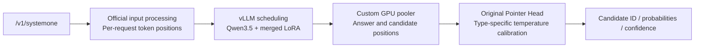

# Strands Decider · vLLM

English | [简体中文](README.zh-CN.md)

An independent inference adapter for Strands Decider v19. It uses vLLM to schedule the Qwen3.5 backbone, scores candidates on the GPU with the original Pointer Head, and retains the `POST /v1/systemone` API.

This repository maintains the vLLM adapter separately from the companion [StrandsDecider payment demo](https://github.com/milan9527/StrandsDecider). The model API is compatible with that demo; the payment demo continues to use its original inference implementation.

## Public HTTPS API

The independent vLLM API runs continuously on an On-Demand EC2 `g6.xlarge` in `us-east-1`.

- Base URL: **https://d1e9udi8st2p3g.cloudfront.net**
- Inference: `POST /v1/systemone`, with a Bearer API key.
- [Interactive API documentation](https://d1e9udi8st2p3g.cloudfront.net/docs) · [Examples and limits](docs/API.md) · [Deployment and operations](deployment/README.md) · [Verification](docs/DEPLOYED.md)

CloudFront reaches the GPU through a private VPC origin. The service admits eight concurrent inference requests, returns 429 when overloaded, and keeps the model loaded between requests. Keys are distributed separately and are excluded from Git. This service is independent of the original payment demo.

## Features

- Merge LoRA through the official loader and export local weights with an integrity manifest.
- Reuse the official text templates, tokenization, candidate positions, temperature calibration, and answer conversion.
- Support `choice`, `noul`, and `score`, including multiple independent questions in one request.
- Score candidates on the GPU through a custom vLLM pooling model, returning only candidate probabilities from the pooler.
- Allow concurrent HTTP requests to enter the vLLM scheduler, with candidate positions stored in each request's own metadata.
- Provide admission limits, timeout cancellation, disconnect cleanup, health checks, behavior comparison, and concurrency benchmarks.

**Real L4 GPU concurrency testing is complete.** On the same hardware, the vLLM repeat run reached **34.91 requests/second** at concurrency 8, compared with **14.76 requests/second** for the original service. P95 latency fell from **542.8 ms to 237.6 ms**. GPU behavior checks passed for 21 requests containing 23 judgments. Across three vLLM runs, 2,555 of 2,560 requests succeeded and selected the same candidates as the original; five requests timed out at higher concurrency. Concurrency levels 4 and 8 each completed 560 requests without failure, making them the recommended starting range. See the [GPU concurrency report](docs/GPU_CONCURRENCY.md) for data and limitations, and the [validation record](docs/VALIDATION.md) for automated checks.

This initial version supports the current v19 Qwen3.5 text backbone, a single GPU, a BF16 backbone, and an FP32 Pointer Head. Dependencies are pinned to vLLM `0.31.0` and Strands Decider commit `63d24ae286e50105fba0bd1db15b0e243aea4650`.

## Request flow



Prefix caching, chunked prefill, and CUDA Graphs are disabled while validating the full prefill path. Questions that share a state are scheduled separately; this initial version does not reuse their common prefix. Decisions come from candidate scoring, without generating JSON text or replacing the head with a fixed-label classifier.

## Export the model

Requirements: Python 3.11–3.13 and [uv](https://docs.astral.sh/uv/). Clone the repository and install the CPU development dependencies:

```bash
git clone https://github.com/milan9527/StrandsDeciderVLLM.git
cd StrandsDeciderVLLM
uv sync --frozen --extra cpu --extra dev
```

Obtain the model weights separately. The example below uses the original v19 checkpoint and Qwen3.5 backbone from a sibling checkout of the payment demo. Replace both paths with your own local directories as needed:

```bash
uv run --no-sync decider-vllm export \
  --checkpoint ../StrandsDecider/.deployment/models/decider \
  --base ../StrandsDecider/.deployment/models/base \
  --output models/decider-vllm

uv run --no-sync decider-vllm verify-artifacts --model models/decider-vllm
```

The export is written to `models/decider-vllm`. The command refuses to overwrite an existing directory; use a new directory for another export. The repository includes examples and collected test evidence. Model weights, runtime caches, and credentials are excluded by `.gitignore`.

## Run on a GPU

You need an NVIDIA GPU, a driver compatible with the CUDA version in the vLLM image, and the NVIDIA Container Toolkit. Start in an isolated test environment. This container binds only to the host's loopback address and mounts the model directory read-only:

```bash
docker build -t strands-decider-vllm:0.1.0 .

docker run --rm --gpus all --shm-size=2g \
  -p 127.0.0.1:8100:8100 \
  -v "$PWD/models/decider-vllm:/models/decider-vllm:ro" \
  strands-decider-vllm:0.1.0
```

Defaults are `max_num_seqs=16`, `max_num_batched_tokens=8192`, and a GPU memory utilization fraction of `0.55`. These are initial settings, not a configuration tuned on g6.xlarge. When sharing a GPU, adjust them to the memory actually available.

The benchmark used `max_num_seqs=32` and a memory fraction of `0.7` on a g6.4xlarge host, with the inference container limited to 4 vCPUs and 14 GiB RAM. Throughput was near its plateau at concurrency 4–8; increasing concurrency to 16 or 32 mainly increased queuing latency.

Alternatively, install directly on a Linux host with a compatible CUDA environment:

```bash
uv sync --frozen --extra gpu --extra dev
uv run --no-sync decider-vllm serve --model models/decider-vllm --port 8100
```

By default, the HTTP layer admits up to 32 unfinished requests, each with up to 32 questions. At most 64 unfinished questions can be submitted to the engine. Requests exceeding HTTP capacity receive 429. After input validation, an inference request exceeding 60 seconds receives 504 and triggers cancellation; cancellation cleanup has a separate timeout of up to two seconds. The service uses one Uvicorn worker, with vLLM scheduling concurrent inference.

```bash
curl -s http://127.0.0.1:8100/health
curl -s http://127.0.0.1:8100/v1/systemone \
  -H 'Content-Type: application/json' \
  --data-binary @examples/payment.json
```

Local startup without `--api-key-file` disables authentication and should remain bound to loopback. The public deployment enables Bearer API key authentication; it does not implement the demo's user login. Integrating it with the demo also requires backend routing and changes to the original project's exclusive lock and inference lease; those changes are outside this implementation.

## Validation and benchmarking

Automated tests:

```bash
uv run --no-sync pytest -q
uv run --no-sync ruff check src tests scripts
```

Real GPU smoke test, loading vLLM rather than a mock engine:

```bash
DECIDER_VLLM_GPU_MODEL="$PWD/models/decider-vllm" \
  uv run --no-sync pytest -q -m gpu
```

The four scenarios and their 20 steps are stored in [payment-corpus.json](examples/payment-corpus.json). [payment.json](examples/payment.json) contains all three judgment types.

Start the official reference service to compare two real endpoints. This helper is for behavior validation. It does not pin every acceleration kernel from the original production environment and must not be used as the original service's performance baseline:

```bash
uv run --no-sync python scripts/reference_server.py \
  --checkpoint ../StrandsDecider/.deployment/models/decider \
  --base ../StrandsDecider/.deployment/models/base \
  --device cuda --port 8099

# Run in another terminal, with both services already started.
uv run --no-sync decider-vllm validate \
  --reference-url http://127.0.0.1:8099 \
  --candidate-url http://127.0.0.1:8100 \
  --corpus examples/payment-corpus.json \
  --concurrency 8 --output artifacts/gpu-parity

uv run --no-sync decider-vllm benchmark \
  --url http://127.0.0.1:8100 \
  --corpus examples/payment-corpus.json \
  --levels 1 2 4 8 16 32 --requests 80 \
  --output artifacts/vllm-concurrency
```

By default, behavior comparison requires the same choices and absolute probability and confidence differences no greater than `0.02`. Differences are saved individually, and failures produce a nonzero exit code. LoRA merging, BF16 rounding, and different kernels can change probabilities; measure these differences rather than expecting bitwise equality.

Before each concurrency level, the benchmark warms up at that concurrency for `max(number of test inputs, 2 × concurrency)` requests. Timing starts afterward to exclude initial batch-kernel compilation. Warmup records are saved separately to `warmups.jsonl`; measured results include successful throughput, P50/P95, failure counts, and raw responses. The load generator uses fixed concurrency with closed-loop clients. This is a load-testing method, separate from the payment demo's autonomous business workflow. Compare services with the same inputs, concurrency, and hardware, and apply load to one service at a time.

See the [adapter guide](docs/ADAPTER.md) for implementation details and limitations.
