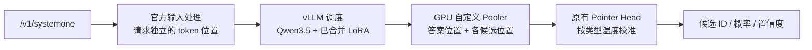

# Strands Decider · vLLM

[English](README.md) | 简体中文

独立的 Strands Decider v19 推理适配项目。使用 vLLM 调度 Qwen3.5 底座，在 GPU 内通过原有 Pointer Head 对候选项评分，继续提供 `POST /v1/systemone`。

本仓库独立维护 vLLM 推理适配，配套支付演示见 [StrandsDecider](https://github.com/milan9527/StrandsDecider)。模型接口兼容原演示；支付演示继续使用原版推理实现。

## 公网 HTTPS API

独立 vLLM API 在 `us-east-1` 按需 EC2 `g6.xlarge` 上常驻运行。

- 服务地址：**https://d1e9udi8st2p3g.cloudfront.net**
- 推理接口：`POST /v1/systemone`，使用 Bearer API Key 鉴权。
- [交互式接口文档](https://d1e9udi8st2p3g.cloudfront.net/docs) · [示例与限制](docs/API.zh-CN.md) · [部署与运维](deployment/README.zh-CN.md) · [验证记录](docs/DEPLOYED.zh-CN.md)

CloudFront 通过 VPC 源站私网访问 GPU。服务最多接收 8 个并发推理请求，过载返回 429，模型在请求之间持续驻留。Key 单独分发，不包含在 Git 中。此服务与原支付演示相互独立。

## 实现范围

- 使用官方加载器合并 LoRA，导出本地权重和校验清单。
- 复用官方文本模板、分词、候选位置、温度校准及答案转换。
- 支持 `choice`、`noul`、`score`，同一请求可以包含多个独立问题。
- 自定义 vLLM pooling 模型，在 GPU 内完成 Pointer Head 运算，只返回候选概率。
- 不同 HTTP 请求可以同时进入 vLLM 调度器；候选位置保存在请求自己的 metadata 中。
- 提供队列限制、超时取消、断连清理、健康检查、结果对齐及并发测试工具。

**已完成真实 L4 GPU 并发测试。** 同一硬件上，并发 8 的 vLLM 复测吞吐量为 **34.91 次/秒**，原版为 **14.76 次/秒**；P95 从 **542.8 ms 降至 237.6 ms**。21 个请求、23 个判断通过 GPU 行为对齐。三轮 vLLM 共测 2560 次，2555 次成功且选择与原版相同，5 次高并发超时；并发 4、8 各累计 560 次均成功，建议先使用这个范围。完整数据和限制见 [GPU 并发报告](docs/GPU_CONCURRENCY.zh-CN.md)，自动化检查见 [验证记录](docs/VALIDATION.zh-CN.md)。

首版只支持当前 v19 的 Qwen3.5 文本底座、单 GPU、BF16 底座及 FP32 Pointer Head。固定 vLLM `0.31.0` 和 Strands Decider 源码提交 `63d24ae286e50105fba0bd1db15b0e243aea4650`。

## 流程



关闭前缀缓存、分块预填充和 CUDA Graph，先验证完整 prefill 路径。同一状态的多个问题分别提交调度，首版不复用它们的公共前缀。不是生成 JSON 文本，也没有改成固定类别分类器。

## 导出模型

需要 Python 3.11–3.13 和 [uv](https://docs.astral.sh/uv/)。先克隆仓库并安装 CPU 开发依赖：

```bash
git clone https://github.com/milan9527/StrandsDeciderVLLM.git
cd StrandsDeciderVLLM
uv sync --frozen --extra cpu --extra dev
```

模型权重需要另行准备。下例使用同级支付演示项目中的原始 v19 checkpoint 与 Qwen3.5 底座；也可以将两条路径替换为自己的本地目录：

```bash
uv run --no-sync decider-vllm export \
  --checkpoint ../StrandsDecider/.deployment/models/decider \
  --base ../StrandsDecider/.deployment/models/base \
  --output models/decider-vllm

uv run --no-sync decider-vllm verify-artifacts --model models/decider-vllm
```

导出结果保存在 `models/decider-vllm`。命令拒绝覆盖已有目录；再次导出请使用新目录。仓库包含示例和已采集的测试证据，模型权重、运行缓存及凭据由 `.gitignore` 排除。

## GPU 启动

需要 NVIDIA GPU、兼容 vLLM 镜像 CUDA 版本的驱动和 NVIDIA Container Toolkit。建议先在独立测试环境中运行。以下容器只监听宿主机回环地址，模型目录只读：

```bash
docker build -t strands-decider-vllm:0.1.0 .

docker run --rm --gpus all --shm-size=2g \
  -p 127.0.0.1:8100:8100 \
  -v "$PWD/models/decider-vllm:/models/decider-vllm:ro" \
  strands-decider-vllm:0.1.0
```

默认 `max_num_seqs=16`、`max_num_batched_tokens=8192`、GPU 显存比例 `0.55`。这些是初始配置，尚未经过 g6.xlarge 性能调优；共享 GPU 时必须根据实际空闲显存调整。

本次测试使用 `max_num_seqs=32`、显存比例 `0.7`，宿主机为 g6.4xlarge，推理容器限制 4 vCPU / 14 GiB。并发 4–8 已接近本次配置的吞吐平台，增加至 16、32 主要增加排队延迟。

也可以在具备兼容 CUDA 环境的 Linux 主机中安装：

```bash
uv sync --frozen --extra gpu --extra dev
uv run --no-sync decider-vllm serve --model models/decider-vllm --port 8100
```

HTTP 默认最多容纳 32 个未完成请求，每个请求最多 32 个问题，最多向引擎提交 64 个未完成问题。超过 HTTP 容量返回 429；输入验证后，推理请求超过 60 秒返回 504 并请求取消推理，取消清理另有最多 2 秒超时。服务使用一个 Uvicorn worker，由 vLLM 调度并发推理。

```bash
curl -s http://127.0.0.1:8100/health
curl -s http://127.0.0.1:8100/v1/systemone \
  -H 'Content-Type: application/json' \
  --data-binary @examples/payment.json
```

本地启动不传 `--api-key-file` 时关闭鉴权，应只绑定回环地址。公网部署启用了 Bearer API Key 鉴权，没有实现演示项目的用户登录。接入演示还需修改后端路由、原项目的独占锁和推理租约；本项目没有进行这些修改。

## 验证与压测

自动化测试：

```bash
uv run --no-sync pytest -q
uv run --no-sync ruff check src tests scripts
```

真实 GPU 冒烟测试（加载真实 vLLM，不使用模拟引擎）：

```bash
DECIDER_VLLM_GPU_MODEL="$PWD/models/decider-vllm" \
  uv run --no-sync pytest -q -m gpu
```

四场景、20 个步骤的测试输入保存在 [payment-corpus.json](examples/payment-corpus.json)，另有包含三种判断类型的 [payment.json](examples/payment.json)。

启动官方参考服务后，对比两个真实接口。此辅助参考服务用于行为校验；它没有固定原生产环境的全部加速内核，不能直接当作原服务的测速基线：

```bash
uv run --no-sync python scripts/reference_server.py \
  --checkpoint ../StrandsDecider/.deployment/models/decider \
  --base ../StrandsDecider/.deployment/models/base \
  --device cuda --port 8099

# 在另一个终端执行；两个服务均应已经启动。
uv run --no-sync decider-vllm validate \
  --reference-url http://127.0.0.1:8099 \
  --candidate-url http://127.0.0.1:8100 \
  --corpus examples/payment-corpus.json \
  --concurrency 8 --output artifacts/gpu-parity

uv run --no-sync decider-vllm benchmark \
  --url http://127.0.0.1:8100 \
  --corpus examples/payment-corpus.json \
  --levels 1 2 4 8 16 32 --requests 80 \
  --output artifacts/vllm-concurrency
```

对齐检查默认要求选择相同、概率及置信度偏差不超过 `0.02`；差异会逐项保存，失败返回非零退出码。LoRA 合并、BF16 舍入和不同计算内核可能改变概率，需要实际测量，不能保证逐位相同。

压测在每个并发档位先以该并发预热 `max(测试输入数, 2 × 并发数)` 次，再开始计时，避免首次批处理内核编译影响数据。预热记录单独保存到 `warmups.jsonl`；正式统计包含成功吞吐量、P50/P95、失败数及原始响应。使用固定并发的闭环负载生成器，**不是业务自主闭环**。比较原服务时请用同样输入、并发和硬件，分别测试，不要同时给两个服务施加负载。

更多实现和限制见 [适配说明](docs/ADAPTER.zh-CN.md)。
