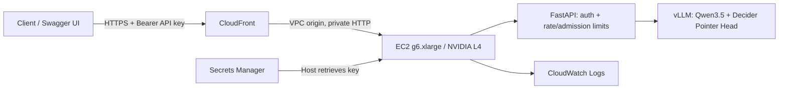

# Public inference API

English | [简体中文](API.zh-CN.md)

This service exposes Strands Decider v19 through an authenticated HTTPS API. It runs the custom vLLM Pointer Head adapter on a continuously running On-Demand EC2 `g6.xlarge` in `us-east-1`.

Base URL: `https://d1e9udi8st2p3g.cloudfront.net`

Interactive API documentation: `https://d1e9udi8st2p3g.cloudfront.net/docs`

## Authentication

Use an API key in the `Authorization: Bearer ...` header. The operator's key is stored in AWS Secrets Manager; the local deployment copy is `.deployment/api-credentials.json` with owner-only permissions. The key is not included in this repository. The initial deployment uses one shared service key, with aggregate limits across its callers.

```bash
export DECIDER_VLLM_URL="https://d1e9udi8st2p3g.cloudfront.net"
export DECIDER_VLLM_API_KEY="YOUR_API_KEY"

curl --fail-with-body --silent --show-error \
  "$DECIDER_VLLM_URL/v1/models" \
  -H "Authorization: Bearer $DECIDER_VLLM_API_KEY"
```

The root page, `/health`, `/docs`, `/redoc`, and `/openapi.json` are readable without a key. Inference and model information require authentication. HTTP is rejected; use HTTPS.

## Endpoints

| Method | Path | Authentication | Purpose |
|---|---|---|---|
| GET | `/` | Public | Service links |
| GET | `/health` | Public | Engine readiness and current pending requests |
| GET | `/docs` | Public | Swagger UI; use **Authorize** to enter the API key |
| GET | `/openapi.json` | Public | OpenAPI schema, including request and response types |
| GET | `/v1/models` | Bearer API key | Model ID, capabilities, and context limit |
| POST | `/v1/systemone` | Bearer API key | Submit business facts, questions, and candidate options |

The inference interface supports `choice`, `noul`, and `score`. It scores candidates through the original Decider head; it is not an OpenAI chat/completions endpoint and does not generate free-form text. An ordinary HTTP client is sufficient; no vendor SDK is required.

## Call the model

The repository's [payment example](../examples/payment.json) submits three independent questions in one request:

```bash
curl --fail-with-body --silent --show-error \
  "$DECIDER_VLLM_URL/v1/systemone" \
  -H "Authorization: Bearer $DECIDER_VLLM_API_KEY" \
  -H 'Content-Type: application/json' \
  --data-binary @examples/payment.json
```

A minimal single-question request:

```json
{
  "state": "Payment received: 129 USDC. Expected amount: 129 USDC. Confirmations: 3 of 12 required. No risk flags.",
  "questions": {
    "action": {
      "type": "choice",
      "instructions": "Choose the next payment handling action using the stated facts.",
      "criteria": {
        "await_confirmations": "Payment matches, but chain confirmations are below the required count.",
        "credit_payment": "Payment matches and the required chain confirmations have been reached.",
        "manual_review": "A risk flag or payment mismatch requires review."
      }
    }
  }
}
```

The response contains `model`, `answers`, `usage`, and `latency_ms`. A `choice` answer contains the selected candidate ID, candidate probabilities, and confidence. `noul` returns a probability; `score` returns an ordinal score, its legend, probabilities, and confidence. `latency_ms` measures server-side processing including queuing; client latency additionally includes HTTPS and network overhead.

See the [actual payment response](../examples/payment-response.json), captured from the deployed GPU. It selects `await_confirmations`; the other two answers report confirmation probability and payment readiness.

Python example:

```python
import json
import os
from pathlib import Path

import httpx

response = httpx.post(
    os.environ["DECIDER_VLLM_URL"] + "/v1/systemone",
    headers={"Authorization": "Bearer " + os.environ["DECIDER_VLLM_API_KEY"]},
    json=json.loads(Path("examples/payment.json").read_text()),
    timeout=40,
)
response.raise_for_status()
print(response.json())
print("Request ID:", response.headers["x-request-id"])
```

## Limits and errors

| Setting | Deployed value |
|---|---:|
| Concurrent HTTP inference requests | 256 |
| Concurrent questions submitted to vLLM | 256 |
| vLLM `max_num_seqs` | 128 |
| vLLM batch token budget | 8192 |
| Context window per question | 4096 tokens; strict validation |
| Questions per request | Up to 32; scheduled within the shared question limit |
| Request body | 1 MiB |
| Aggregate API rate | 120000 requests/minute, implemented as a 2000 requests/second token bucket |
| Initial / maximum burst | 512 requests |
| Inference deadline | 25 seconds, plus up to 2 seconds for cancellation cleanup |

Authentication is checked before request-body buffering. Multi-question requests share 256 question slots, and vLLM schedules up to 128 sequences within its 8192-token batch budget. These are admission limits, not a throughput guarantee. The [1–128 capacity test](CONCURRENCY_128.md) measured about 30–34 successful requests/second at higher concurrency on its short inputs.

| Status | Meaning | Client action |
|---|---|---|
| 401 | Missing or invalid key | Check the Bearer header |
| 413 | Body too large | Reduce the input |
| 422 | Invalid schema, unsupported image input, or context-window violation | Correct the request |
| 429 | Rate or concurrency limit reached | Respect `Retry-After` and reduce concurrency |
| 503 | Inference engine unavailable | Check `/health`; retain the request ID |
| 504 | Inference deadline exceeded | Retain the request ID for diagnosis; do not count the call as a successful decision |

Responses include `X-Request-ID` and `Cache-Control: no-store`. Logs correlate HTTP requests with preprocessing and engine request IDs without logging API keys or request bodies. CloudFront uses disabled caching and forwards the Authorization header.

## Deployment and operational scope



The instance accepts inference traffic only from the CloudFront VPC origin service security group. Its public IPv4 address is used for outbound downloads and AWS management access; port 8100 and SSH are not open to the internet. Source artifacts and model weights are stored in a private, encrypted S3 bucket with all public-access blocks enabled. ECR stores a private copy of the built container image.

Systemd keeps the container running. Docker health checks and a systemd timer restart an unhealthy service. GPU, weights, and compilation caches remain available between requests; there is no idle shutdown. This is a single-GPU deployment without automatic horizontal scaling or multi-AZ failover.

The deployment fixes a cancellation-wait race in the HTTP disconnect watcher and adds request correlation logs. Historical benchmark timeouts remain in the [benchmark evidence](GPU_CONCURRENCY.md); the old measurements are not rewritten. The later [1–128 test](CONCURRENCY_128.md) completed 12,800 requests without HTTP failures or changed candidate choices, while preserving one numeric-tolerance failure. Its expanded service settings are retained.

See the [deployment guide](../deployment/README.md) for operations and the [live deployment record](DEPLOYED.md) for endpoint verification.
