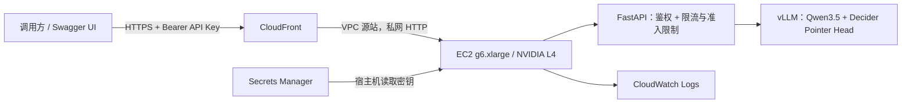

# 公共推理接口

[English](API.md) | 简体中文

本服务通过带鉴权的 HTTPS API 提供 Strands Decider v19 推理，在 `us-east-1` 常驻按需 EC2 `g6.xlarge` 上运行自定义 vLLM Pointer Head 适配。

服务地址：`https://d1e9udi8st2p3g.cloudfront.net`

交互式 API 文档：`https://d1e9udi8st2p3g.cloudfront.net/docs`

## 鉴权

请求头使用 `Authorization: Bearer ...`。服务密钥保存在 AWS Secrets Manager；部署人员的本地副本为 `.deployment/api-credentials.json`，仅文件所有者可读写，密钥不进入仓库。初始部署使用一个共享服务密钥，限额由所有调用者共同使用。

```bash
export DECIDER_VLLM_URL="https://d1e9udi8st2p3g.cloudfront.net"
export DECIDER_VLLM_API_KEY="YOUR_API_KEY"

curl --fail-with-body --silent --show-error \
  "$DECIDER_VLLM_URL/v1/models" \
  -H "Authorization: Bearer $DECIDER_VLLM_API_KEY"
```

根路径、`/health`、`/docs`、`/redoc` 和 `/openapi.json` 无需密钥即可查看。推理和模型信息接口需要鉴权。HTTP 请求会被拒绝，必须使用 HTTPS。

## 接口

| 方法 | 路径 | 鉴权 | 用途 |
|---|---|---|---|
| GET | `/` | 公开 | 服务入口链接 |
| GET | `/health` | 公开 | 引擎就绪状态及当前未完成请求数 |
| GET | `/docs` | 公开 | Swagger UI；点击 **Authorize** 输入 API Key |
| GET | `/openapi.json` | 公开 | OpenAPI 定义，包括输入和输出类型 |
| GET | `/v1/models` | Bearer API Key | 模型 ID、支持的能力及上下文限制 |
| POST | `/v1/systemone` | Bearer API Key | 提交业务事实、问题与候选项 |

推理支持 `choice`、`noul` 和 `score`，通过原始 Decider 决策头计算候选得分。这不是 OpenAI chat/completions 接口，不生成自由文本。使用普通 HTTP 客户端即可，无需厂商 SDK。

## 调用模型

仓库中的 [支付示例](../examples/payment.json) 一次提交三个独立问题：

```bash
curl --fail-with-body --silent --show-error \
  "$DECIDER_VLLM_URL/v1/systemone" \
  -H "Authorization: Bearer $DECIDER_VLLM_API_KEY" \
  -H 'Content-Type: application/json' \
  --data-binary @examples/payment.json
```

最小单问题请求：

```json
{
  "state": "Payment received: 129 USDC. Expected amount: 129 USDC. Confirmations: 3 of 12 required. No risk flags.",
  "questions": {
    "action": {
      "type": "choice",
      "instructions": "Choose the next payment handling action using the stated facts.",
      "criteria": {
        "await_confirmations": "Payment matches, but chain confirmations are below the required count.",
        "credit_payment": "Payment matches and the required chain confirmations have been reached.",
        "manual_review": "A risk flag or payment mismatch requires review."
      }
    }
  }
}
```

响应包括 `model`、`answers`、`usage` 和 `latency_ms`。`choice` 答案包含选中的候选 ID、各候选概率及置信度；`noul` 返回概率；`score` 返回有序分数、图例、概率及置信度。`latency_ms` 是包括排队在内的服务端处理时间；客户端耗时还包含 HTTPS 和网络往返。

可查看部署后由真实 GPU 返回的 [支付响应示例](../examples/payment-response.json)：动作选择为 `await_confirmations`，另外两个答案分别提供确认概率和支付就绪程度。

Python 示例：

```python
import json
import os
from pathlib import Path

import httpx

response = httpx.post(
    os.environ["DECIDER_VLLM_URL"] + "/v1/systemone",
    headers={"Authorization": "Bearer " + os.environ["DECIDER_VLLM_API_KEY"]},
    json=json.loads(Path("examples/payment.json").read_text()),
    timeout=40,
)
response.raise_for_status()
print(response.json())
print("Request ID:", response.headers["x-request-id"])
```

## 限制与错误

| 配置 | 部署值 |
|---|---:|
| 并发 HTTP 推理请求 | 256 |
| 同时提交给 vLLM 的问题 | 256 |
| vLLM `max_num_seqs` | 128 |
| vLLM 批次 token 预算 | 8192 |
| 每个问题的上下文窗口 | 4096 token，严格校验 |
| 每个请求的问题数 | 最多 32，共享引擎问题并发限额 |
| 请求体大小 | 1 MiB |
| API 总速率 | 120000 次/分钟，以每秒补充 2000 个令牌的令牌桶实现 |
| 初始 / 最大突发额度 | 512 次请求 |
| 推理截止时间 | 25 秒；取消清理最多额外 2 秒 |

先鉴权，再缓存请求体。多问题请求共享 256 个问题槽位，vLLM 在 8192 token 的批次预算内调度最多 128 个序列。这些是准入上限，不代表实际吞吐量；[1–128 容量测试](CONCURRENCY_128.zh-CN.md) 对短输入测得的高并发成功吞吐约为每秒 30–34 次。

| 状态码 | 含义 | 客户端处理 |
|---|---|---|
| 401 | 缺少或错误的密钥 | 检查 Bearer 请求头 |
| 413 | 请求体过大 | 缩小输入 |
| 422 | 格式错误、图片输入不支持或超出上下文窗口 | 修正请求 |
| 429 | 超过速率或并发限制 | 遵循 `Retry-After` 并降低并发 |
| 503 | 推理引擎不可用 | 检查 `/health` 并保留请求 ID |
| 504 | 推理超时 | 保留请求 ID 用于排查，不计为成功决策 |

响应包含 `X-Request-ID` 和 `Cache-Control: no-store`。日志通过请求 ID 关联 HTTP、预处理与引擎请求，不记录 API Key 或请求体。CloudFront 禁用缓存并转发 Authorization 请求头。

## 部署与运行范围



实例仅接受来自 CloudFront VPC 源站服务安全组的推理流量。公网 IPv4 用于下载和 AWS 管理出站访问，8100 端口和 SSH 均未向公网开放。源码工件和模型权重保存在私有加密 S3 bucket，四项公共访问阻止全部开启。构建后的容器镜像保存在私有 ECR 中。

Systemd 保持容器运行；Docker 健康检查和 systemd timer 会重启不健康的服务。GPU、权重及编译缓存持续保留，没有闲置停机。这是单 GPU 部署，未配置水平自动扩缩容或跨可用区故障切换。

本次部署修复了 HTTP 断连监听中取消等待的竞态，并增加请求关联日志。历史超时仍保留在 [并发测试证据](GPU_CONCURRENCY.zh-CN.md) 中，原始测量数据不改写。后续 [1–128 测试](CONCURRENCY_128.zh-CN.md) 完成 12,800 次请求，无 HTTP 失败或候选变化，并保留一项数值阈值失败；放开后的服务配置已保留。

运维方式见 [部署指南](../deployment/README.zh-CN.md)，接口验收见 [在线部署记录](DEPLOYED.zh-CN.md)。
