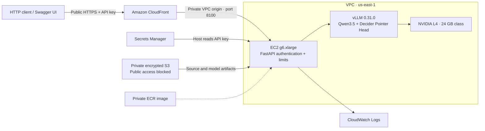

# Public API deployment record

English | [简体中文](DEPLOYED.zh-CN.md)

Deployed and verified on **2026-10-13**, independently of the original payment demo.

The current limits were expanded after the [1–128 capacity test](CONCURRENCY_128.md). The initial launch acceptance results below retain their original eight-request configuration and measurements.

- Service: **https://d1e9udi8st2p3g.cloudfront.net**
- Inference: `POST /v1/systemone`, Bearer API key required.
- [Interactive documentation](https://d1e9udi8st2p3g.cloudfront.net/docs) · [API examples](API.md) · [Operations](../deployment/README.md)

## Architecture and configuration

| Setting | Deployed configuration |
|---|---|
| Region / AZ | `us-east-1` / `us-east-1d` |
| EC2 | On-Demand `g6.xlarge`, 4 vCPUs, 16 GiB RAM |
| GPU | NVIDIA L4; driver `595.91.07` |
| Storage | Encrypted 160 GiB gp3; weights and caches persist on stop/start |
| Model | Decider v19; merged BF16 backbone and original FP32 Pointer Head |
| Runtime | vLLM `0.31.0`, one Uvicorn worker |
| HTTP / question / engine concurrency | 256 / 256 / 128 |
| Rate-limit threshold | Shared 2000 requests/second token bucket, burst 512; actual throughput is lower |
| Context / batch token budget | 4096 per question / 8192 |
| Inference deadline | 25 seconds, plus cancellation cleanup |
| Availability | Always on; systemd startup and health recovery; single instance |
| Image digest | `sha256:0bd44d374991dc8782b93d58bb41b3aab63fa0d242149578b342cb139f371d07` |

CloudFront caching is disabled and Authorization is forwarded. The EC2 security group accepts port 8100 only from the CloudFront VPC origin service security group; direct public access failed the connection probe as expected. IMDSv2 is required with hop limit one. All S3 public-access blocks are enabled. The key lives in Secrets Manager and an ignored local file with mode 0600.

## Initial public HTTPS acceptance results

The client ran on the deployment workstation, using the actual public HTTPS URL and real GPU inference. These are short acceptance measurements, including network overhead. They are not a sustained throughput benchmark or a latency guarantee for other client locations.

| Phase | Requests | Result | Mean client latency | P50 | P95 |
|---|---:|---|---:|---:|---:|
| Original-model parity, sequential | 21 | 21 passed; 23 judgments | 58.7 ms | 56.2 ms | 70.9 ms |
| Concurrency 8, paced batches | 160 | 160 succeeded | 219.5 ms | 243.3 ms | 251.0 ms |
| Intentional burst at concurrency 64 | 64 | 9 succeeded; 55 returned 429 | — | — | — |

The eight-request batches had a 0.6-second pause between batches to stay within the rate limit. All **190 successful inference responses** matched the original candidate choices, with numeric differences within the existing 0.02 tolerance. No inference call returned 5xx or timed out in this acceptance run. All overload rejections included `Retry-After`, and pending requests returned to zero afterward.

All 22 endpoint checks passed, covering missing/wrong keys, authentication before input validation, authenticated model listing, request schema, body-size limit, HTTP rejection, Swagger/OpenAPI, unique request IDs, disabled response caching, parity, overload, and capacity recovery.

The test demonstrates API correctness and short-run behavior preservation. Matching the original model does not mean the model is always correct for the business scenario.

## Changes from the earlier benchmark

The public service adds Bearer authentication, rate/admission limits, request tracing, and a fix for an HTTP disconnect-watcher cancellation race. A local test reproduced the race: inference completed but watcher cleanup stalled until the deadline. The watcher now waits directly for ASGI disconnect messages.

This does not prove that all five timeouts in the earlier high-concurrency benchmark had the same cause. The [historical benchmark](GPU_CONCURRENCY.md) and its 33 evidence hashes remain unchanged. The public service uses different admission settings and a g6.xlarge host, so these results are recorded separately.

Local automated checks: **33 passed, one GPU pytest test skipped on the CPU workstation**. The HTTPS tests above separately executed the real GPU model. All nine exported model-file hashes passed, and the deployed Python source hashes match this checkout.

Evidence: [endpoint checks](results/public-api-2026-10-13/verification.json), [raw responses](results/public-api-2026-10-13/requests.jsonl), [infrastructure checks](results/public-api-2026-10-13/infrastructure-verification.json), [model integrity](results/public-api-2026-10-13/model-integrity.json), and [source hashes](results/public-api-2026-10-13/source-sha256.json).

There is one shared API key, one GPU, and no multi-AZ failover or automatic scaling. The original payment demo retains its own GPU and inference implementation.
