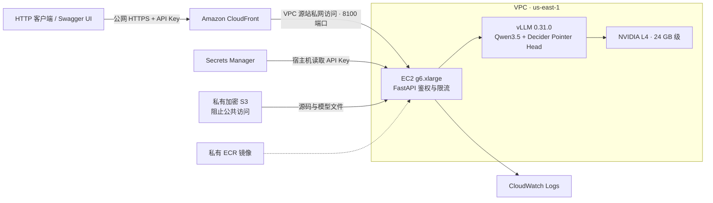

# 公网 API 部署记录

[English](DEPLOYED.md) | 简体中文

**2026-10-13** 完成部署与验证，与原支付演示相互独立。

当前限额已在 [1–128 容量测试](CONCURRENCY_128.zh-CN.md) 后提高。下文初次上线的验收数据保留当时的 8 请求配置和原始测量。

- 服务地址：**https://d1e9udi8st2p3g.cloudfront.net**
- 推理接口：`POST /v1/systemone`，需要 Bearer API Key。
- [交互式文档](https://d1e9udi8st2p3g.cloudfront.net/docs) · [API 示例](API.zh-CN.md) · [运维说明](../deployment/README.zh-CN.md)

## 架构与配置

| 项目 | 实际配置 |
|---|---|
| 区域 / 可用区 | `us-east-1` / `us-east-1d` |
| EC2 | 按需 `g6.xlarge`，4 vCPU、16 GiB 内存 |
| GPU | NVIDIA L4；驱动 `595.91.07` |
| 存储 | 加密 160 GiB gp3；停止再启动保留权重和缓存 |
| 模型 | Decider v19；合并后的 BF16 底座与原始 FP32 Pointer Head |
| 运行时 | vLLM `0.31.0`，一个 Uvicorn worker |
| HTTP / 问题 / 引擎并发 | 256 / 256 / 128 |
| 速率拒绝阈值 | 共享每秒 2000 请求令牌桶，突发容量 512；实际吞吐量低于该值 |
| 上下文 / 批次 token 预算 | 每问题 4096 / 批次 8192 |
| 推理超时 | 25 秒，另加取消清理时间 |
| 运行方式 | 常驻；systemd 开机启动与健康恢复；单实例 |
| 镜像摘要 | `sha256:0bd44d374991dc8782b93d58bb41b3aab63fa0d242149578b342cb139f371d07` |

CloudFront 禁用缓存并转发 Authorization。EC2 安全组只允许 CloudFront VPC 源站服务安全组访问 8100 端口，公网直连探测按预期失败。IMDSv2 必须启用，跳数限制为 1。S3 的所有公共访问阻止项均开启。Key 保存在 Secrets Manager 及被 Git 忽略、权限为 0600 的本地文件中。

## 初次上线的公网 HTTPS 验收

客户端在部署工作机上通过实际公网 HTTPS 地址调用真实 GPU 模型。以下是包含网络开销的短时验收数据，不是持续吞吐基准，也不保证其他地区客户端有相同延迟。

| 阶段 | 请求数 | 结果 | 客户端平均耗时 | P50 | P95 |
|---|---:|---|---:|---:|---:|
| 原版结果对齐，逐个请求 | 21 | 21 组通过，共 23 个判断 | 58.7 ms | 56.2 ms | 70.9 ms |
| 8 并发，分批限速 | 160 | 160 次成功 | 219.5 ms | 243.3 ms | 251.0 ms |
| 主动发起 64 并发突发请求 | 64 | 9 次成功；55 次返回 429 | — | — | — |

每批 8 请求之间暂停 0.6 秒，以保持在限流范围内。全部 **190 个成功推理响应** 的候选选择与原版一致，数值差异满足原有 0.02 阈值。本轮验收没有推理 5xx 或超时。所有过载拒绝都包含 `Retry-After`，完成后待处理请求恢复为零。

22 项接口检查全部通过，覆盖无 Key / 错误 Key、输入校验前鉴权、需鉴权的模型列表、请求格式、请求体限制、拒绝 HTTP、Swagger/OpenAPI、唯一请求 ID、禁用响应缓存、结果对齐、过载及容量恢复。

这些测试验证接口行为与短时的原版结果保持情况。与原版选择一致，不代表模型对业务问题的判断始终正确。

## 相比早期基准的变化

公网版本增加 Bearer 鉴权、速率与并发限制、请求追踪，并修复 HTTP 断连监听的取消等待竞争问题。本地测试复现了“推理已完成，但监听任务清理一直等待到超时”的问题，现改为直接等待 ASGI 断连消息。

这不能证明早期高并发基准中的 5 次超时都有相同原因。[历史基准](GPU_CONCURRENCY.zh-CN.md) 及其 33 项记录哈希保持不变。公网服务使用不同的并发准入设置和 g6.xlarge 主机，因此结果单独记录。

本地自动化检查：**33 项通过，CPU 工作机上的一个 GPU pytest 测试跳过**。上述 HTTPS 验证另行执行了真实 GPU 模型。导出的 9 个模型文件哈希全部通过，部署的 Python 源码哈希与当前工作区一致。

原始记录：[接口检查](results/public-api-2026-10-13/verification.json)、[逐请求响应](results/public-api-2026-10-13/requests.jsonl)、[基础设施检查](results/public-api-2026-10-13/infrastructure-verification.json)、[模型完整性](results/public-api-2026-10-13/model-integrity.json)、[源码哈希](results/public-api-2026-10-13/source-sha256.json)。

当前只有一个共享 API Key、一个 GPU，没有跨可用区故障切换或自动扩缩容。原支付演示保留自己的 GPU 与推理实现。
