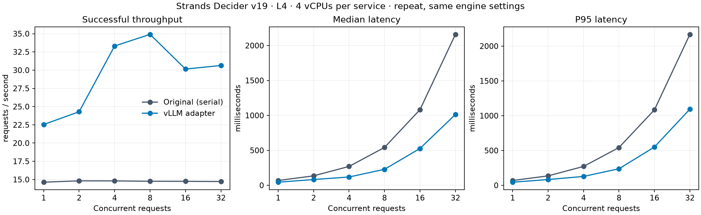

# GPU 并发实测

2026-10-13，比较原部署 Decider 镜像和本项目的 vLLM 适配。两者使用相同 v19 模型、相同输入，分别独占同一块 NVIDIA L4 GPU。

**vLLM 已实现真实并发提速，当前配置建议先使用并发 4–8。** 并发 8 的吞吐量约为原版的 2.36 倍，P95 降低约 56%。提高到 16、32 没有继续提升吞吐量，且高并发测试中累计发生 5 次约 60 秒的超时，根因尚未确定。

## 对比结果

以下为相同配置的第二轮 vLLM 测量与原版基线，每档均 80 次，启动和预热已排除。本轮全部成功；首轮及延长测试的失败见后文，没有将失败从原始数据中删除。

| 并发 | 原版 RPS | vLLM RPS | 原版 P50 / P95 ms | vLLM P50 / P95 ms |
|---:|---:|---:|---:|---:|
| 1 | 14.63 | 22.55 | 68.4 / 69.1 | 44.3 / 44.8 |
| 2 | 14.82 | 24.29 | 134.9 / 135.5 | 82.2 / 82.8 |
| 4 | 14.81 | 33.31 | 269.9 / 271.0 | 118.8 / 127.5 |
| 8 | 14.76 | 34.91 | 541.5 / 542.8 | 228.5 / 237.6 |
| 16 | 14.75 | 30.15 | 1082.0 / 1084.4 | 526.7 / 549.9 |
| 32 | 14.73 | 30.64 | 2160.0 / 2168.4 | 1013.8 / 1094.6 |



原版约 14.7 RPS，增加并发主要增加串行排队。vLLM 单请求耗时从约 68 ms 降到 44 ms，并能通过批处理减少并发请求的排队。当前收益同时涉及 LoRA 合并、不同 PyTorch / CUDA 内核、CPU 线程设置和调度，不能全部归因于批处理。

`max_num_seqs=32` 是上限，并不表示任意 32 条输入都能同时处理；8192 token 的批次预算也会限制调度。当前配置在并发 4–8 附近已到吞吐平台，更多请求会继续排队。这里的 RPS 是单次决策请求吞吐量，不是每秒完成的支付业务流程数。

## 超时与延长测试

首轮 vLLM 在并发 16 的 80 次请求中有 2 次超时，整档耗时 61.08 秒，成功吞吐量降至 **1.28 RPS**；其他档位成功。相同配置复测 480 次全部成功，随后将并发 4、8、16、32 各延长到 400 次：

| 并发 | 成功 / 总请求 | 成功 RPS | 平均 ms | P50 ms | P95 ms | 超时 |
|---:|---:|---:|---:|---:|---:|---:|
| 4 | 400 / 400 | 33.31 | 119.9 | 119.9 | 126.7 | 0 |
| 8 | 400 / 400 | 34.93 | 228.5 | 230.1 | 233.2 | 0 |
| 16 | 400 / 400 | 30.21 | 528.3 | 528.8 | 542.9 | 0 |
| 32 | 397 / 400 | 6.44 | 943.7 | 940.7 | 1040.3 | 3 |

**延迟分位数只统计成功请求，超时仍计入失败数和整档耗时。** 因此并发 32 的成功请求 P95 约 1 秒，但 3 次约 60 秒的超时仍将成功吞吐量拉低到 6.44 RPS，不能只看 P95 就认为该档位正常。

三轮 vLLM 共 **2560 次正式请求，2555 次成功、5 次超时**。每个并发 4、8 档位累计测了 560 次，没有失败。三轮测量没有改变推理引擎配置；未定位的偶发超时不能解释为“冷启动已修复”，也不能据此给出生产 SLA。

行为方面，所有 **2555 个成功响应的候选选择均与原版一致**，概率与置信度也满足 0.02 阈值。初始检查有 4 条置信度差恰好为 0.02，被浮点表示 `0.020000000000000018` 误报，修正后重新检查；原始误报记录保留在 `vllm-concurrency/behavior-audit-before-float-fix.json`。这项修正没有改变模型答案或放宽阈值，也没有把超时变成成功。

本轮结论支持继续以并发 4–8 做集成测试。切换线上前仍需定位超时，并测长输入、长时间持续负载、多问题请求和原 ECS 后端的并发限制。

数据：[首轮完整对比](results/gpu-concurrency-2026-10-13/table.md) · [同配置复测](results/gpu-concurrency-2026-10-13/table-vllm-recheck.md) · [延长测试](results/gpu-concurrency-2026-10-13/table-vllm-extended.md) · [校验清单与逐条响应](results/gpu-concurrency-2026-10-13/verification.json)。

## 测试条件

| 项目 | 设置 |
|---|---|
| AWS | us-east-1，临时 On-Demand `g6.4xlarge` |
| GPU | NVIDIA L4，24 GB 级显存，驱动 595.91.07 |
| 推理资源 | 每个服务均限制 CPU affinity `0–3`、内存 14 GiB |
| 压测客户端 | 同主机、独立容器，CPU `4–5`、内存 4 GiB |
| 原版 | 原生产镜像固定 digest，官方 Decider + PyTorch + FLA，串行执行 |
| vLLM | 0.31.0，合并 LoRA，BF16 底座，原始 FP32 Pointer Head |
| vLLM 调度 | `max_num_seqs=32`、`max_num_batched_tokens=8192`、显存比例 0.7 |
| CPU 线程 | 原版保留 `OMP_NUM_THREADS=4`；vLLM 按启动建议使用 1 |
| 其他 | 单 GPU；关闭 CUDA Graph、前缀缓存、分块预填充 |
| 请求 | `POST /v1/systemone`，回环 HTTP，包含输入处理、排队、推理及响应 |
| 并发档位 | 1、2、4、8、16、32 |
| 输入 | 四个支付场景 × 五个步骤，共 20 个不同的单问题请求 |
| 输入长度 | 304–445 token，平均 373.9 token |
| 首轮 / 复测 | 每档 80 次，每个输入重复 4 次；每轮 480 次正式请求 |
| 延长测试 | 并发 4、8、16、32，每档 400 次；共 1600 次 |
| 预热 | 每档先按该并发执行 `max(20, 2 × 并发)` 次；六档测量排除 176 次，四档延长测试排除 136 次 |

`g6.xlarge` 和 `g6.2xlarge` 在尝试的可用区容量不足，因此使用同为单卡 L4 的 `g6.4xlarge` 并限制推理容器资源。主机仍是 g6.4xlarge，不能将数据称为 g6.xlarge 的直接实测。客户端使用额外 CPU；若迁移至只有 4 vCPU 的实例，应从其他主机发压并重新验证。

两个实现按顺序测量，避免抢占 GPU。模型启动、镜像构建及预热不计入正式性能。测量不经过 CloudFront、ECS API、DynamoDB 或公网，因此不能与原演示网站的完整请求耗时直接比较。

## 统计和行为校验

固定数量客户端 worker 持续提交请求，完成一个再提交下一个；这是压测负载方式，与支付业务的“自主闭环”无关。RPS 为成功请求数 / 整档耗时；P50、P95 使用成功请求延迟的 nearest-rank 分位数。P95 表示该档 95% 的成功请求延迟不高于此值。

先从原版捕获四场景 20 个请求和一个包含 `choice`、`noul`、`score` 的混合请求，共 21 个请求、23 个判断；再与 vLLM 实际响应比较。随后对每条正式压测响应按 case ID 与原版捕获结果核对：

- `choice` 必须选择相同候选 ID。
- 概率、置信度、`noul` 及 `score` 数值绝对偏差不超过 0.02。
- HTTP 200 还需通过问题完整性、候选 ID 和概率合法性检查。

重复请求用于观察并发下是否出现结果串线或数值变化，不代表新增了 480 个独立业务样本。原版和适配版一致也不代表业务决策正确；引擎适配没有修改权重或纠正原模型错误。

## 复现

导出模型和构建镜像见 [README](../README.md)。实际 vLLM 测量配置：

```bash
docker run --rm --gpus all --shm-size=2g \
  --cpuset-cpus=0-3 --memory=14g \
  -p 127.0.0.1:8100:8100 \
  -v "$PWD/models/decider-vllm:/models/decider-vllm:ro" \
  strands-decider-vllm:0.1.0 serve \
  --model /models/decider-vllm --host 0.0.0.0 --port 8100 \
  --gpu-memory-utilization 0.7 --max-num-seqs 32 \
  --max-num-batched-tokens 8192
```

原版必须使用已固定的生产模型镜像；`scripts/reference_server.py` 只作行为参考，其内核栈不同，不能替代该性能基线。分别启动、采集、关闭原版和 vLLM，避免同时占用 GPU：

```bash
python scripts/gpu_experiment.py capture \
  --url http://127.0.0.1:8099 \
  --corpus examples/payment-corpus.json --mixed examples/payment.json \
  --output artifacts/reference-capture.json

decider-vllm benchmark --url http://127.0.0.1:8099 \
  --corpus examples/payment-corpus.json --levels 1 2 4 8 16 32 \
  --requests 80 --output artifacts/reference-concurrency

python scripts/gpu_experiment.py audit \
  --reference artifacts/reference-capture.json \
  --requests artifacts/reference-concurrency/requests.jsonl \
  --output artifacts/reference-concurrency/behavior-audit.json

# 关闭原版，启动 vLLM 后，使用新输出路径采集并压测。
python scripts/gpu_experiment.py capture \
  --url http://127.0.0.1:8100 \
  --corpus examples/payment-corpus.json --mixed examples/payment.json \
  --output artifacts/vllm-capture.json

python scripts/gpu_experiment.py compare \
  --reference artifacts/reference-capture.json \
  --candidate artifacts/vllm-capture.json --output artifacts/gpu-parity.json

decider-vllm benchmark --url http://127.0.0.1:8100 \
  --corpus examples/payment-corpus.json --levels 1 2 4 8 16 32 \
  --requests 80 --output artifacts/vllm-concurrency

python scripts/gpu_experiment.py audit \
  --reference artifacts/reference-capture.json \
  --requests artifacts/vllm-concurrency/requests.jsonl \
  --output artifacts/vllm-concurrency/behavior-audit.json
```

采集脚本额外预热 21 次并单独记录，性能统计只取 `benchmark.json` 和正式 `requests.jsonl`。报告脚本 `scripts/report_gpu_concurrency.py` 从逐条数据复算统计，并生成图表及 SHA-256 清单。

## 资源收尾

2026-10-13 08:27 UTC 已确认临时 EC2 终止，EBS 磁盘、临时 S3 bucket、IAM role / instance profile 和安全组均已删除。结果已下载到本项目。原生产 g6.xlarge 仍在运行，演示网站返回 HTTP 200，本次未切换线上流量或推送 GitHub。

清理确认见 [cleanup.json](results/gpu-concurrency-2026-10-13/cleanup.json)，本地 26 项测试、代码检查及源码哈希见 [local-checks.json](results/gpu-concurrency-2026-10-13/local-checks.json)。
